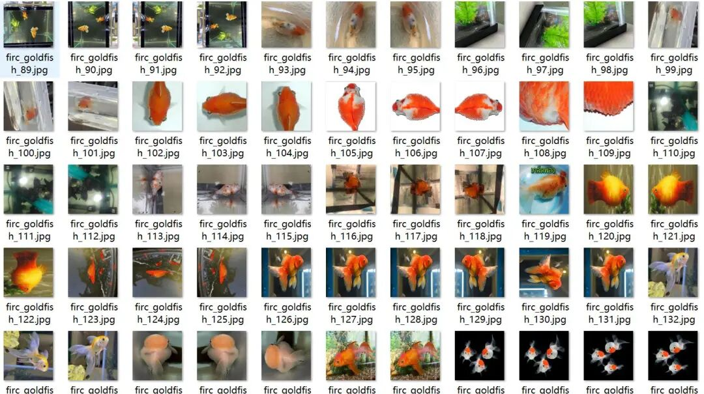
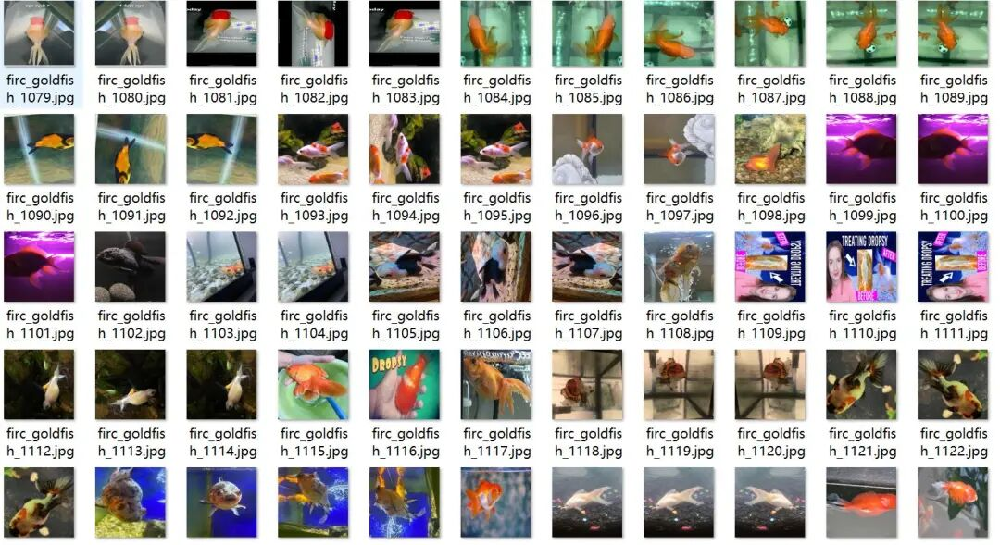
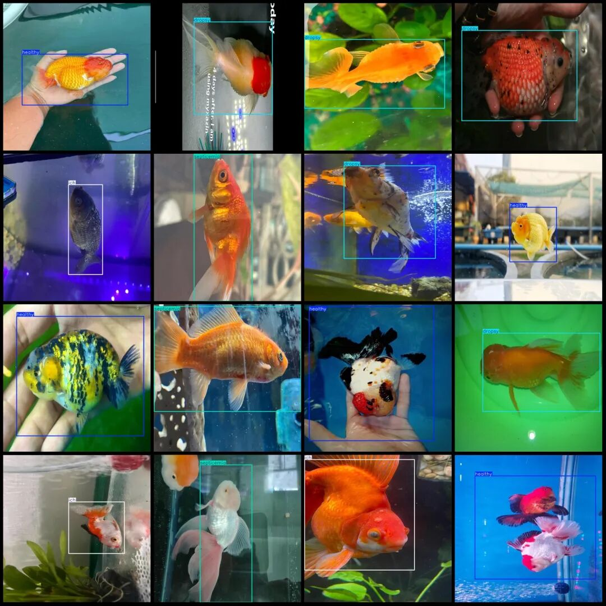

# Goldfish Disease Detection Dataset VOC+YOLO format with 1371 images in 4 categories

Dataset format: Pascal VOC format + YOLO format (txt file without split path, only containing jpg images and corresponding VOC format xml files and yolo format txt files)

Number of images (number of jpg files): 1371

Number of annotations (number of xml files): 1371

Number of annotations (number of txt files): 1371

Labeling category count: 4

Label category names (Note that the order of yolo format categories does not correspond to this, but is based on the labels folder's classes.txt): ["dropsy", "healthy", "ich", "septicemia"]

Number of boxes labeled in each category:

Dropsy (ascites) frame count = 331

Healthy (health) frame count = 1068

ich (white spot disease) frame count = 282

Septicemia (sepsis) Frame count = 395

Total frame count: 2076

Image resolution: 640x640

Is the dataset enhanced: Yes, about 300 are original images with the remaining being enhanced ones, mainly including flipping enhancements.

Using labelImg:

Annotation rules: Draw a rectangle around the category.

Important Notice: No

Special : This dataset does not guarantee the accuracy of the trained models or weight files.

Image Preview:

Annotation example:

## Payment

Here is a pay link on Stripe ( https://buy.stripe.com/3cs8yP7sY87d0vu9AB ). Please contact me lonlonago@foxmail.com after funding $89, and I will send you a complete data files , thank you!

